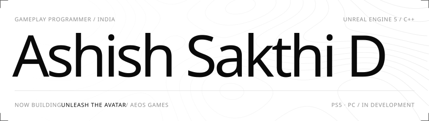

<a href="https://ashish-sakthi.vercel.app"><picture><source media="(prefers-color-scheme: dark)" srcset="https://raw.githubusercontent.com/Ashish-Sakthi/Ashish-Sakthi/main/assets/banner-dark.svg"></picture></a>

<p align="right"><a href="https://ashish-sakthi.vercel.app">Portfolio</a> &nbsp;·&nbsp; <a href="https://www.linkedin.com/in/iamashishsakthi/">LinkedIn</a> &nbsp;·&nbsp; <a href="mailto:iamashishsakthid@gmail.com">Email</a> &nbsp;·&nbsp; <a href="https://ashish-sakthi.vercel.app/Ashish-Sakthi-D-Resume.pdf">Resume</a></p>

```cpp
UCLASS()
class UAshishSakthi : public UGameplayProgrammer
{
    GENERATED_BODY()

    UPROPERTY(VisibleAnywhere) FString Studio  = TEXT("Aeos Games");
    UPROPERTY(VisibleAnywhere) FString Project = TEXT("Unleash The Avatar");
    UPROPERTY(VisibleAnywhere) TArray<FName> Platforms = { "PS5", "PC" };

    // Combat.GAS  AI.Enemies  Systems.Progression  Platform.PS5  Perf.CPU_GPU
    UPROPERTY(VisibleAnywhere) FGameplayTagContainer Focus;
};
```

### Now building

**[Unleash The Avatar](https://store.steampowered.com/app/4054220/Unleash_The_Avatar/)**, a soulslike set in Indian mythology for PlayStation 5 and PC. I work across most of the gameplay code and own the PS5 port and PC performance.

[Trailer ↗](https://www.youtube.com/watch?v=0CTKnEcjESw) &nbsp; [Wishlist on Steam ↗](https://store.steampowered.com/app/4054220/Unleash_The_Avatar/)

### Systems I build

| Area | Work |
| :-- | :-- |
| **Combat** | Gameplay Ability System: abilities, AttributeSets, Execution Calculations, cues, parry and posture |
| **Enemy AI** | Behavior Trees, EQS, perception and noise, scripted encounters, boss phases |
| **Game systems** | Save / load, progression, inventory and loot tables, quests and dialogue |
| **World** | World Partition streaming, triggers, switches and puzzles, Sequencer cinematics |
| **Platform** | PlayStation 5 port, PC performance, DLSS / FSR / XeSS upscaling |
| **Tooling** | Editor tools in C++ and Python, build automation, profiling with Unreal Insights |

### Projects

| Project | About | Built with |
| :-- | :-- | :-- |
| **[Top-Down RPG](https://ashish-sakthi.vercel.app/projects/img_rpg)** | Spells, levelling, Behavior Tree + EQS enemies | `UE5 · GAS` |
| **[Third Person Shooter](https://ashish-sakthi.vercel.app/projects/img1)** | Pure C++ shooter with patrol / chase / search AI | `UE5 · C++` |
| **[Obstacle Overrun](https://ashish-sakthi.vercel.app/projects/img2)** | Platforms, spinning bars, traps, timed jumps | `UE5 · C++` |
| **[Toon Tanks](https://ashish-sakthi.vercel.app/projects/img3)** | Tanks vs. turrets that track and fire back | `UE5 · C++` |
| **[Interactive Skills Enhancer](https://github.com/Ashish-Sakthi/Intractive-Skill-Enhancer)** | VR social-skills trainer. SIH 2024 finalist | `Unity · VR` |

### Toolkit

**Engine** &nbsp; `Unreal Engine 5` `Blueprints` `GAS` `Behavior Trees` `EQS` `Niagara` `Sequencer` `World Partition` `Unity`<br>
**Code** &nbsp; `C++` `C#` `Python` `Lua`<br>
**Tools** &nbsp; `Unreal Insights` `Visual Studio` `Rider` `Git` `Blender`
